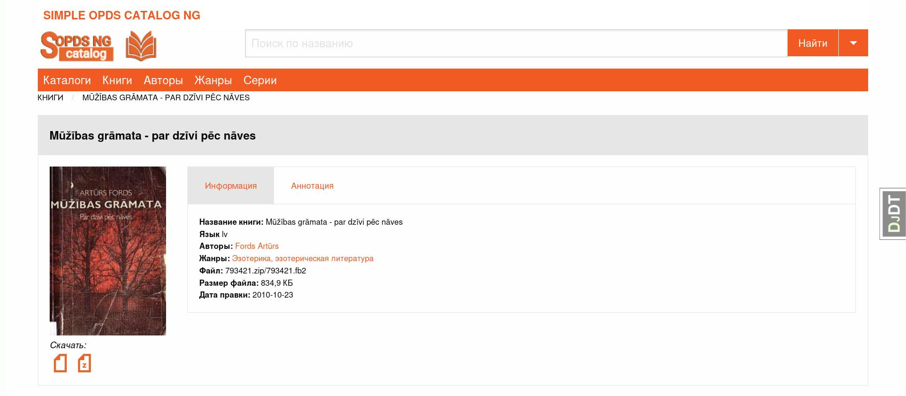

# SimpleOPDS Каталог НП (новое поколение) — SimpleOPDS Catalog NG

Based on SimpleOPDS Catalog by Dmitry V.Shelepnev
Author: Valery A. Ilychev
Версия 1.0.0

[Английская версия README.md](README.md)
[Документация по развёртыванию](docs/deploy.md) |
[Документация по миграции](docs/migration.md)

Это форк проекта [SimpleOPDS Catalog](https://github.com/mitshel/sopds) Дмитрия Шелепнева. Исходный проект неактивен с апреля 2019 года.

Относительно исходного проекта внесены следующие изменения:

1. Протестирована работа только с базой данных PostgreSQL. Django поддерживает другие СУБД, и, скорее всего, SOPDS-NG сможет работать и с mysql, и с sqlite, но это требует дополнительного тестирования.
2. Переработка базовой верстки.
3. Возможность запустить SOPDS-NG в контейнере docker/podman.
4. Исправлены выявленные ошибки; применены изменения сторонних контрибьюторов из pull-реквестов к исходному проекту.
5. Для работы приложения используется wsgi-сервер gunicorn. Встроенный сервер django не используется.
6. Структура исходного кода реорганизована для более удобного управления.
7. Используются современные инструменты управления (uv, mypy и т.п.).

Все изменения вносятся в ветку dev текущего репозитория.

#### Технический стэк

- Python 3.13
- Django 5.2
- PostgreSQL 17
- gunicorn
- docker

---

## Docker образ

Готовые multi-arch образы (amd64/arm64) публикуются в [ghcr.io/sarutobi/sopds-ng](https://github.com/sarutobi/sopds-ng/pkgs/container/sopds-ng):

- `ghcr.io/sarutobi/sopds-ng:latest` — последняя версия из master
- `ghcr.io/sarutobi/sopds-ng:master` — ветка master

---

## Быстрый старт

[Инструкция](docs/quickstart.md) для быстрого старта
